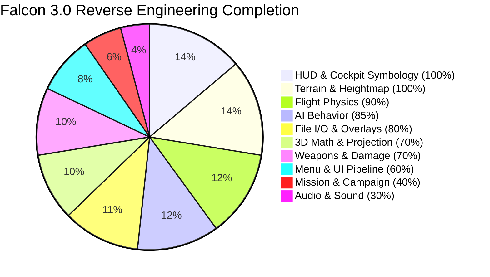

# Falcon 3.0 — Comprehensive Systems Status & Disassembly Roadmap

**Date**: November 2026  
**Project Objective**: Complete disassembly, structural reversing, and high-fidelity technical specification of Spectrum HoloByte's *Falcon 3.0* (`FALCONCD.EXE`).

---

## 1. Executive Summary & Infrastructure Status

The reverse engineering foundation is fully operational, stabilized, and standardized:

* **Executable**: `FALCONCD.EXE` — 118 KB resident image + 1.2 MB RTLink/Plus dynamic overlay tail. Compiled with Borland C++ 2.0 (`bcc -ml -1 -O`) combined with extensive hand-crafted 80x86 real-mode assembly.
* **Single Source of Truth (Pure JSON)**:
  * `registry/functions.json`: **3,194 functions** cataloged with linear addresses, sizes, caller counts, and descriptions.
  * `registry/structs.json`: **42 structures** fully specified with byte offsets, types, and comments.
  * `registry/enums.json`: **28 enums and bitmasks** covering weapons, radar states, and entity lifecycle flags.
  * `registry/globals.json`: **172 global variables** with DS-relative offsets and types.
* **IDA Pro 9.1 Automation**:
  * Headless batch execution via `idat.exe -A -S...`.
  * Structure synchronization (`sync_structs_to_ida.py`): All 42 structs and 28 enums live in `FALCONCD.EXE.i64`.
  * Structure offset tagging (`apply_struct_offsets.py`): Automated equivalent of the IDA **`T`** key (`idc.op_stroff`) transforming raw displacements (e.g. `[di+4]`) into labeled struct members (e.g. `[di+AIContext.behavior_flags]`).

---

## 2. Current Status by System

### Detailed Subsystem Breakdown

| System | % Done | Status | Key Decoded Assets & Functions | Outstanding Questions / Missing Logic |
|---|---|---|---|---|
| **HUD & Symbology** | **100%** | Complete | `hud_readout_render_coordinator`, pitch ladder, compass rose, weapon reticles, energy-maneuverability readouts. | None. Full rendering flow mapped. |
| **Terrain System** | **100%** | Complete | 512×512 tile world grid, 13,108 unit tiles, bilinear heightmap interpolation (`terrain_tile_heightmap_sample`), `.ISL/.DAT` quadtree vectors. | World coordinate conversion for multi-tile coastline vectors. |
| **Flight Physics** | **90%** | Highly Advanced | `flight_control_axes_read_normalize` (±2048 limits), 13-word `FlightKinematics` block at DS:0x32, 40-entity `AircraftSlot` array. | Fine-grained stall dynamics and high-AoA buffeting lookup curves. |
| **AI System** | **85%** | Highly Advanced | Master `behavior_dispatcher` (`0x3CE92`), 40 `AIContext` records at `0x65A7:0x000C`, target prioritization, combat maneuvers (split-S, scissors). | Multi-flight formation coordination and RTB (return to base) fuel heuristics. |
| **File I/O & Overlays** | **80%** | Advanced | `op_dispatch` (`0x2257B`, 16 DOS services), RTLink 18-byte directory parser, `.IDX/.DAT` menu graphics loaders, `rle_vga_decompressor` (`0x088460`). | Exact compression algorithm for non-RLE sub-assets (DCL implode verification). |
| **3D Engine Core** | **70%** | Moderate | `fixed_vec3_accumulate_a` (`0x022C91`, dot-product core with 51k+ calls/frame), `view_projection` (`0x020BDB`), 14-bit angular rotation. | 10 math helper functions in checklist, trig/reciprocal tables in Segment `0x7772`. |
| **Weapons & Combat** | **70%** | Moderate | 37 `WeaponType` entries, IR seeker lock search loop (`weapon_aim9_seeker_lock_check`), hardpoint station definitions, damage bitmasks. | Impact detection (`store_impact_step`), warhead blast radius calculation, projectile ballistic trajectories. |
| **Menu & UI State** | **60%** | Moderate | Universal input poller (`input_poll_handler` @ `0x12FC43`), master menu coordinator (`0x33443`), VGA palette upload (`0x4F271`). | R45/R57 complex UI menu event dispatching and screen transition sequencing. |
| **Mission & Campaign** | **40%** | Early / Incomplete | `.SQU` 2703-byte file layout (`SquadronHeader`, `PilotRecord[30]`), theater loader (`0x15A8B0`), waypoint structures. | Dynamic campaign war turn generator, front-line territory shifting, victory conditions. |
| **Audio System** | **30%** | Early | AdLib/OPL2 FM synthesis port `0x388` verified, sound device detection (`sound_device_init` @ `0x1740D`). | Sound effect priority mixing, Roland MT-32 / MIDI sequence parser, voice/radio engine. |

---

## 3. Disassembly Roadmap & Dig-In Options

Depending on the project's next milestone, here are the **5 high-impact options** for deep-dive reversing:

### 🎯 Option 1: Weapons Ballistics, Impact & Damage Engine
* **Goal**: Close the loop from weapon firing to target destruction.
* **Why this matters**: We already have weapon selection and seeker lock reversed; we need the terminal mechanics (hit detection, explosive radius, and subsystem damage).
* **Key Targets**:
  * `store_impact_step` (`0x39840`, 1,403 bytes): Analyzes bomb and missile release.
  * Target hit handler: Inspect `target_hit_output.txt` and map `EntitySlotRecord` field updates (+0x10 impact state, +0xCA damage flags).
  * Projectile motion dispatch: Category 9–14 update routines (`hw_config_flags_build`).

### 🗺️ Option 2: Dynamic Campaign & Mission Flow System
* **Goal**: Understand how Falcon 3.0 runs its revolutionary dynamic war.
* **Why this matters**: Falcon 3.0's dynamic campaign was groundbreaking. Much of `.SQU` and `.WAR` is still undocumented.
* **Key Targets**:
  * `theater_campaign_file_loader` (`0x15A8B0`, 2,553 bytes, 102 callers): Reverse the campaign theater state machine.
  * Squadron management: Map pilot skill degradation, fatigue accumulation (+0x29 in `PilotRecord`), and kill tracking.
  * Campaign turn evaluation: Find where front lines, airbase supply, and target destruction propagate to the overall war status.

### 📐 Option 3: 3D Math Pipeline & Segment 0x7772 Lookups
* **Goal**: Complete the [docs/ida_verification_checklist.md](file:///C:/Users/yotam/projects/falcon3/docs/ida_verification_checklist.md).
* **Why this matters**: Fully clarifies the engine's fixed-point trigonometric and perspective division algorithms.
* **Key Targets**:
  * Verify the 10 predicted math helpers from `seg015:0C65` through `seg020:1A2F`.
  * Map Segment `0x7772` offset `0x0F34`: Sample the 32-bit values to determine whether it is sine/cosine, atan2, or reciprocal 1/z perspective scaling.
  * Resolve far call target `0x1994:0D94`.

### 🕹️ Option 4: The Mega-Coordinators (Overlays R48 & R53)
* **Goal**: Dissect the game mode orchestrators connecting briefing menus to 3D cockpit flight.
* **Why this matters**: These are the two largest monolithic functions in the game and control execution mode transitions.
* **Key Targets**:
  * `game_mode_r48_main_coordinator` (`0x1744B0`, 9,061 bytes, 360 callers).
  * `game_mode_r53_main_coordinator` (`0x1820B0`, 12,693 bytes, 342 callers): Contains a custom bytecode/opcode interpreter loop driving game mode events.

### 🔊 Option 5: Audio & Hardware Sound Drivers
* **Goal**: Document the OPL2 FM sound effects and Roland MT-32 driver implementation.
* **Why this matters**: Lowest completion rate in the project (~30%), with relatively self-contained code.
* **Key Targets**:
  * OPL register writes at port `0x388` and `0x389`.
  * Sound effect priority queue and multi-channel voice assignment.
  * MIDI sequence parsing routines.

---

## 4. Recommended Immediate Action

> **Recommendation**: **Option 1 (Weapons & Damage)** or **Option 3 (3D Math Verification Checklist)**.
>
> - **Option 1** lets us leverage our freshly minted `EntitySlotRecord`, `AGWeaponEntity`, and `WeaponType` structs to immediately turn raw pointer offsets into crystal-clear combat logic.
> - **Option 3** allows us to quickly complete the pending verification checklist in [docs/ida_verification_checklist.md](file:///C:/Users/yotam/projects/falcon3/docs/ida_verification_checklist.md) and demystify the core mathematical projection tables.
