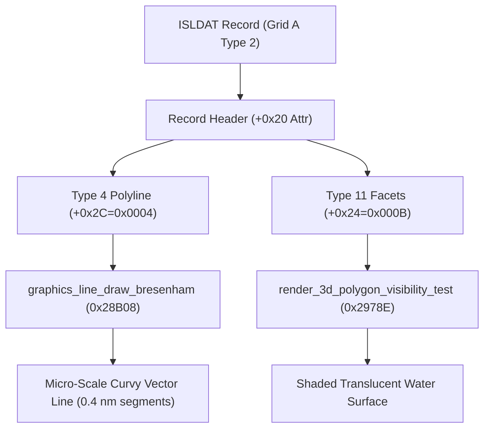

# Falcon 3.0 Rivers, Roads, and Transportation Architecture

This document presents the complete architectural specification and visual decoding of **rivers, waterways, and ground transportation networks** across all 8 theaters in Falcon 3.0.

---

## 1. Architectural Separation: Rivers vs. Roads

In Falcon 3.0, rivers and roads serve fundamentally different simulation roles and are stored in separate subsystems:

| Dimension | Hydrographic Features (Rivers & Canals) | Ground Transportation Networks (Roads & Rail) |
|---|---|---|
| **Data Source** | `ISLDAT.<theater>` (Grid A, Type 2 macro-cell index) | `<THEATER>.THE` (Node database) & `<THEATER>.STR` (Names) |
| **Representation** | Dual: 3D Facets (Type 11) + Centerline Polylines (Type 4) | Directed Node-Link Adjacency Flow Graph (78 bytes/node) |
| **Curviness Scale** | High micro-scale curviness (segments down to $0.4\text{ nm}$ / $700\text{ m}$) | Piecewise linear links between strategic nodes / intersections |
| **3D Engine Role** | In-flight Bresenham vector line + shaded waterbed polygon | Choke point ground target objects (`MAPOBJ`) |
| **Campaign Role** | Specular radar reflector, natural barrier | Supply routes, convoy throughput (`CAPACITY`), bridge interdiction |
| **Disassembly Entry** | `terrain_vector_feature_render_3d` (`0x28874`) | `campaign_graph_find_route` (`0x13C57C`) |

---

## 2. River Architecture (`ISLDAT` Type 4 Subrecords)

### Micro-Scale Curviness & Dual-Representation
Unlike coarse terrain tiles, river channels are stored with high-density polyline vertices:
- **Centroid**: 32-bit $16.16$ fixed-point coordinates $(X, Y, Z)$ in nautical miles.
- **Type 4 (`0x0004`) Centerline Subrecord**: An ordered array of $(w_0, w_1, w_2)$ 3D relative coordinates. In-flight, `terrain_vector_feature_render_3d` (`0x28874`) calls `graphics_line_draw_bresenham` (`0x28B08`) to render crisp, curving vector lines.
- **Type 11 (`0x000B`) Polygonal Surface Facets**: Closed rings forming the waterbed polygon shaded with translucent water fill.

### Theater River Census
- **Iraq (`IRQ`)**: 7 comprehensive records tracing the Tigris and Euphrates rivers flowing northwest to southeast through Baghdad into the Persian Gulf.
- **Panama (`PAN`)**: 9 records mapping the entire Panama Canal, Gatun Lake passages, and the Chagres River connecting the Pacific and Caribbean.
- **Hokkaido (`HOK`)**: 2 records tracing the Ishikari and Tokachi rivers.
- **Israel (`ISR`)**: Record `0x0DB2` (13 vertices, Jordan River flowing into the Dead Sea) and Record `0x0CD4` (14 vertices, Wadi El-Arish in Sinai).
- **Korea (`KOR`) & Bosnia (`BOS`)**: 8 and 5 records representing inland river and canal systems.



---

## 3. Strategic Transportation & Road Network (`<THEATER>.THE`)

### Node-Link Adjacency Flow Graph
Ground transportation is modeled as an exact directed graph of $N$ nodes. Each node conforms to a 78-byte fixed record:

```
CampaignNodeRecord (78 bytes):
+0x00  uint16_t  target_type     (0 Airbase, 1 Airfield, 2 City, 3 Town, 7 Bridge, 8 Oil, 9 Industrial, 14 Rail Yard)
+0x02  uint8_t   allegiance      (0 Allied, 1 Enemy)
+0x03  uint8_t   pattern         (Convoy formation pattern)
+0x04  uint16_t  capacity        (Maximum vehicles/hour throughput)
+0x06  uint16_t  mapobj_id       (Link to physical 3D object in MAPOBJ.<theater>)
+0x08  uint8_t   campaign_state[56] (Ground combat units, damage state, supply levels)
+0x40  int16_t   pos_x           (Tactical map X coordinate: -8192..8191)
+0x42  int16_t   pos_y           (Tactical map Y coordinate: -8192..8191)
+0x44  uint8_t   neighbors[10]   (Adjacency list of linked node IDs terminated by 0xFF)
```

### Strategic Bridges as Campaign Choke Points
- Bridges (Target Type 7) span rivers and waterways.
- When a bridge is destroyed by an air strike, the campaign engine severs the neighbor adjacency edge in `neighbors[10]`, dropping road capacity to zero.
- Ground combat convoys (`ENEMY-C`) and supply trucks (`ENEMY-NC`) are forced to halt or reroute via `campaign_graph_find_route` (`0x13C57C`).

---

## 4. Visual Verification Maps

### Master Comparison Sheets

````carousel

<!-- slide -->

````

### Detailed Theater Maps

````carousel

<!-- slide -->

<!-- slide -->

<!-- slide -->

<!-- slide -->

<!-- slide -->

````

---

## 5. Reverse Engineering & Codebase Artifacts

- **Vector Map Generator**: [scripts/build_full_vector_maps.py](file:///C:/Users/yotam/projects/falcon3/scripts/build_full_vector_maps.py)
- **Road Network Generator**: [scripts/build_road_network_maps.py](file:///C:/Users/yotam/projects/falcon3/scripts/build_road_network_maps.py)
- **Terrain Architecture Documentation**: [docs/architecture/terrain.md](file:///C:/Users/yotam/projects/falcon3/docs/architecture/terrain.md#L708-L820)
- **IDA Disassembly Database**: [analysis/ida_falconcd/FALCONCD.EXE.i64](file:///C:/Users/yotam/projects/falcon3/analysis/ida_falconcd/FALCONCD.EXE.i64)
- **Function Registry**: [registry/functions.json](file:///C:/Users/yotam/projects/falcon3/registry/functions.json)
- **Struct Registry**: [registry/structs.json](file:///C:/Users/yotam/projects/falcon3/registry/structs.json)
